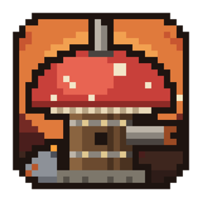
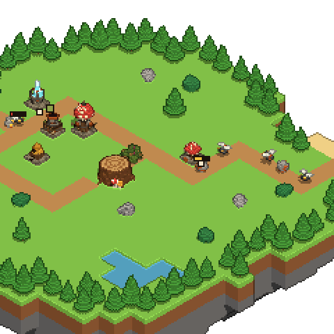

<div align="center">



# Tiny Shrooms: Spore Siege

**Un tower defense sur une île flottante : la Rouille débarque, défends la souche.**

[](https://github.com/Magicelian/spore-siege/releases/latest/download/Spore-Siege-Mac-Apple-Silicon.dmg)
[](https://github.com/Magicelian/spore-siege/releases/latest/download/Spore-Siege-Mac-Intel.dmg)
[](https://github.com/Magicelian/spore-siege/releases/latest/download/Spore-Siege-Windows.exe)




</div>

## 🍄 Le jeu

- 🦠 **La Rouille débarque sur les plages** : limaces, moucherons, scarabées blindés et amas qui se divisent en
  mourant. Ils suivent le sentier jusqu'à la souche et la mordent.
- 🏰 **Quatre tours pour les arrêter**, chacune en trois stades :
  - 🐝 le **poste-ruche**, qui tire vite ;
  - 💎 l'**obélisque de cristal**, dont l'éclair rebondit de monstre en monstre ;
  - 🪨 le **mortier à tourbe**, qui ralentit tout ce qu'il touche ;
  - 🍄 le **canon à spores**, qui fait des dégâts de zone.
- 🌿 **Les ronces ferment une branche du sentier** : bien placées, elles allongent le chemin des monstres.
- ⭐ **Dix vagues par île, jusqu'à trois étoiles** selon la vie qu'il reste à la souche. Les spores des monstres
  vaincus paient les tours ; lancer une vague plus tôt en rapporte davantage.
- 📖 **Un grimoire** décrit chaque monstre rencontré et chaque tour.

Une partie dure environ un quart d'heure. La première île, la forêt, est jouable ; les quatre autres arrivent.
La fenêtre fait 480 × 480 pixels et reste au-dessus des autres.

## 📦 Installer

Un clic sur le lien qui correspond à ton ordinateur, et le téléchargement démarre :

| Ordinateur | Télécharger |
|---|---|
| 🍎 **Mac Apple Silicon** (puce M1, M2, M3, M4…) | [Spore-Siege-Mac-Apple-Silicon.dmg](https://github.com/Magicelian/spore-siege/releases/latest/download/Spore-Siege-Mac-Apple-Silicon.dmg) |
| 🍏 **Mac Intel** (Mac d'avant fin 2020) | [Spore-Siege-Mac-Intel.dmg](https://github.com/Magicelian/spore-siege/releases/latest/download/Spore-Siege-Mac-Intel.dmg) |
| 🪟 **Windows** | [Spore-Siege-Windows.exe](https://github.com/Magicelian/spore-siege/releases/latest/download/Spore-Siege-Windows.exe) |

Pour savoir quel Mac tu as : menu Pomme → **À propos de ce Mac**. « Puce » = Apple Silicon, « Processeur Intel » = Intel.

<details>
<summary><b>🍎 Mac : installation pas à pas</b></summary>

1. Ouvre le `.dmg` et glisse **Tiny Shrooms Spore Siege** dans **Applications**.
2. Le jeu n'est pas signé par Apple, donc macOS le bloque au premier lancement. Deux façons de le débloquer :
   - **Réglages Système → Confidentialité et sécurité**, puis **Ouvrir quand même** en bas de la page ;
   - ou, dans le Terminal, une fois le jeu dans Applications :
     ```bash
     xattr -cr "/Applications/Tiny Shrooms Spore Siege.app"
     ```
3. Le jeu n'apparaît pas dans le Dock : il vit dans la **barre des menus**, en haut de l'écran 🍄.

</details>

<details>
<summary><b>🪟 Windows : installation pas à pas</b></summary>

1. Lance `Spore-Siege-Windows.exe`.
2. Si SmartScreen affiche un avertissement : **Informations complémentaires**, puis **Exécuter quand même**.
3. L'icône du jeu apparaît dans la zone de notification, en bas à droite.

</details>

## 🎮 Jouer

| Action | Commande |
|---|---|
| Construire, améliorer, vendre, poser une ronce | **clic** sur une case |
| Déplacer la fenêtre | **glisser** |
| Déplacer la vue | `⌘` + glisser (`Ctrl` sous Windows) |
| Zoomer | **molette** |
| Tourner l'île | `Q` `E` |
| Pause | `Espace` |
| Fermer la bulle | `Échap` |

⚙ regroupe la taille de la fenêtre, le son (coupé au départ), le grimoire et le retour à la carte.

Le **menu de l'icône** (clic droit sur l'icône de la barre des menus ; clic gauche pour afficher ou cacher la
fenêtre) règle aussi la taille et le son, et montre où en est la mise à jour.

🔄 Les mises à jour se téléchargent seules : quand l'une d'elles est prête, une petite flèche apparaît sur l'icône
et **Redémarrer pour passer à la version…** dans son menu.
